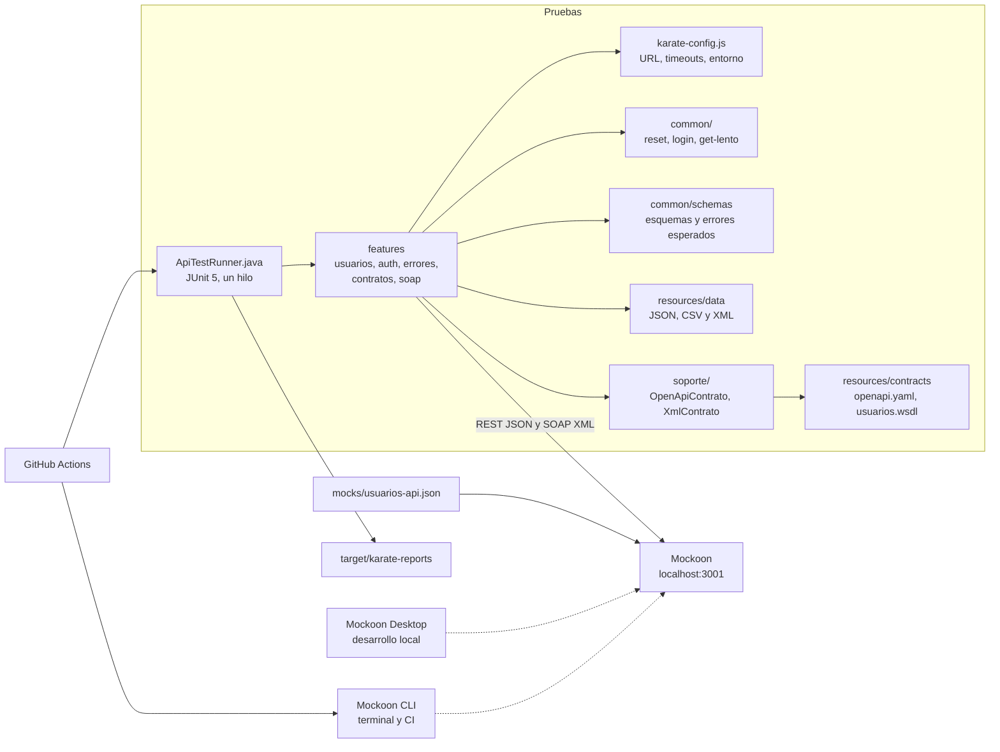

# POC API REST con Karate DSL y Mockoon

Prueba de concepto de automatización de pruebas de servicios backend con Karate DSL: una API REST y un servicio SOAP de usuarios simulados con Mockoon, con validación de contratos OpenAPI y WSDL/XSD. Nació como contraparte de [poc_api_rest_playwright_mockoon](https://github.com/RicardoPavezCatrileo/poc_api_rest_playwright_mockoon) (Python, Playwright y Pytest), que prueba la misma API REST; al final de este documento se comparan caso por caso. El mock de esta POC se extendió con el servicio SOAP, que no existe en la otra.

Todas las credenciales, tokens y API Keys de este repositorio son ficticios y exclusivamente de laboratorio.

## Objetivos

- Automatizar pruebas de servicios REST y SOAP con features reutilizables, `Scenario Outline` y datos externos.
- Validar flujos CRUD, autenticación, autorización, errores HTTP, timeouts y contratos de respuesta.
- Validar las respuestas contra contratos formales: OpenAPI 3 para REST y el XML Schema del WSDL para SOAP.
- Distinguir un timeout del cliente de una respuesta HTTP 504 o 524.
- Ejecutar la misma suite en local, con Mockoon Desktop, y en GitHub Actions, con Mockoon CLI.
- Documentar una estrategia de ramas para trabajar en equipo.

## Arquitectura



```text
.github/workflows/api-tests.yml   Workflow de CI
.github/pull_request_template.md  Plantilla de pull request
.vscode/settings.json             Configuración de Visual Studio Code
docs/branching-strategy.md        Estrategia de ramas
mocks/usuarios-api.json           Entorno de Mockoon: API REST y servicio SOAP
src/test/java/
  ApiTestRunner.java              Punto de entrada único de la suite
  karate-config.js                URL base, timeouts y entornos local y ci
  logback-test.xml                Log HTTP en target/karate.log
  common/                         Features reutilizables (@ignore), esquemas y campos-sensibles.js
  soporte/                        Validadores de contrato en Java: OpenAPI y XSD del WSDL
  health/ usuarios/ auth/ errores/ contratos/ soap/   Features
src/test/resources/
  contracts/                      openapi.yaml y usuarios.wsdl
  data/                           Datos de prueba en JSON y CSV; data/soap/ con los mensajes XML
```

Cambios respecto de la estructura inicial, con su motivo:

- `health/health.feature`: el health check no pertenece a `usuarios/` ni a `contratos/`.
- `common/get-lento.feature`: aísla la llamada con timeout corto para capturar el error (ver [Timeouts](#timeouts)).
- `common/campos-sensibles.js`: busca campos sensibles sin distinguir mayúsculas y en objetos anidados, algo que un esquema `#notpresent` no hace.
- `soap/`, `soporte/` y `src/test/resources/contracts/`: servicio SOAP y contratos formales, agregados para cubrir pruebas SOAP, WSDL/XSD y OpenAPI.

### Ejecución en un solo hilo

`ApiTestRunner` ejecuta `Runner.path("classpath:").parallel(1)`. Mockoon guarda los usuarios en un único data bucket compartido y cada escenario que modifica datos lo restablece con `POST /api/test/reset`: dos escenarios en paralelo se pisarían los datos. Los features de `common/` llevan `@ignore` y solo se ejecutan cuando otro los llama.

## Tecnologías

Versiones verificadas en Maven Central y GitHub el 2026-11-10.

| Herramienta | Uso | Versión |
|---|---|---|
| Java (JDK) | Lenguaje y ejecución | 21 (probado con 21.0.1) |
| Maven | Build | 3.9.9, mediante Maven Wrapper 3.3.4 |
| Karate (`io.karatelabs:karate-junit5`) | Pruebas de API | 1.5.2 |
| `com.atlassian.oai:openapi-request-validator-core` | Validación de respuestas contra OpenAPI (no hace solicitudes) | 3.0.0 |
| APIs XML del JDK (`javax.xml.validation`) | Validación de mensajes SOAP contra el XSD del WSDL | Incluidas en Java 21 |
| maven-surefire-plugin | Ejecución de pruebas | 3.6.1 |
| maven-compiler-plugin | Compilación | 3.16.0 |
| Mockoon Desktop | Mock local con visualización de solicitudes | Probado con 9.10.0 |
| Mockoon CLI | Mock en terminal y CI | 9.10.0 |
| Node.js | Ejecución de Mockoon CLI | Probado con 26.13.0 |
| GitHub Actions | Integración continua | checkout v7, setup-java v6, setup-node v7, upload-artifact v7 |

**Por qué Karate 1.5.2 y no 2.x:** la última versión estable de Karate es 2.1.4, pero solo publica integración con JUnit 6 (`karate-junit6`). `karate-junit5` llega hasta 1.5.2, y el proyecto se definió con JUnit 5.

## Instalación

Requisitos: Windows 11 con PowerShell, JDK 21, Node.js 18 o superior y Mockoon Desktop. Maven no es necesario: el wrapper descarga Maven 3.9.9 la primera vez.

```powershell
java -version
.\mvnw.cmd -v
```

### Visual Studio Code

Abra la carpeta del proyecto. Con **Extension Pack for Java** reconoce el `pom.xml`. Para resaltar y ejecutar `.feature` puede instalar la extensión de Karate, aunque no es obligatoria: todo se ejecuta con Maven.

## Configuración

`src/test/java/karate-config.js` centraliza la configuración:

| Valor | Por defecto | Cómo cambiarlo |
|---|---|---|
| `baseUrl` | `http://localhost:3001` | `-DbaseUrl=http://host:puerto` |
| `karate.env` | `local` | `-Dkarate.env=ci`; cualquier otro valor falla |
| `timeouts.connectMs` | 5000 | En el archivo |
| `timeouts.readMs` | 20000 | Timeout general y timeout suficiente |
| `timeouts.shortReadMs` | 5000 | Timeout corto del cliente |
| `timeouts.slowDelayMs` | 15000 | Debe coincidir con el retardo de `/api/usuarios/lento` en el mock |
| `maxResponseTimeMs` | 2000 | Umbral de tiempo de respuesta |

El entorno `ci` desactiva el formato legible de solicitudes y respuestas en el log, porque Mockoon CLI ya registra cada transacción.

## Endpoints

| Método | Endpoint | HTTP | Notas |
|---|---|---|---|
| GET | `/api/health` | 200 | Estado del servicio |
| GET | `/api/usuarios` | 200 | Usuarios actuales |
| GET | `/api/usuarios/{id}` | 200, 404 | |
| GET | `/api/usuarios/999` | 404 | Ruta estática |
| GET | `/api/usuarios/lento` | 200 | Retardo de 15 s |
| POST | `/api/usuarios` | 201, 400, 422 | Requiere los cuatro campos; el id se genera solo |
| PUT | `/api/usuarios/{id}` | 200, 400, 404, 422 | Requiere los cuatro campos y reemplaza el usuario |
| PATCH | `/api/usuarios/{id}` | 200, 400, 404, 422 | Acepta solo los campos que cambian |
| DELETE | `/api/usuarios/{id}` | 204, 404 | Sin cuerpo ni `Content-Type` |
| POST | `/api/auth/login` | 200, 401 | Entrega un token Bearer |
| GET | `/api/secure/usuarios` | 200, 401, 403 | Requiere token Bearer |
| GET | `/api/apikey/usuarios` | 200, 401 | Requiere `X-API-Key` |
| GET | `/api/errores/{codigo}` | El indicado | 400, 401, 403, 404, 409, 422, 429, 500, 502, 503, 504 y 524 |
| POST | `/api/test/reset` | 200 | Solo para laboratorio: restablece los usuarios |
| POST | `/soap/usuarios` | 200, 500 | Servicio SOAP 1.1: `ObtenerUsuario` y `ListarUsuarios`; los errores son SOAP Fault |
| GET | `/soap/usuarios?wsdl` | 200 | WSDL del servicio SOAP |

El contrato completo de la API REST está en [`src/test/resources/contracts/openapi.yaml`](src/test/resources/contracts/openapi.yaml), y el del servicio SOAP en [`usuarios.wsdl`](src/test/resources/contracts/usuarios.wsdl).

Cuerpo de POST y PUT: `nombre`, `email`, `rol` (`admin`, `supervisor` o `usuario`) y `activo`. No se aceptan otros campos, incluido `id`.

Los usuarios viven en memoria, en el data bucket `usuarios`: los cambios se pierden al reiniciar Mockoon o al llamar a `POST /api/test/reset`. **Ejecutar la suite restablece los datos**, así que borra los cambios hechos a mano.

## Autenticación

| Usuario | Contraseña | Token | Resultado en `/api/secure/usuarios` |
|---|---|---|---|
| `qa_user` | `demo123` | `token-demo-12345` | 200 |
| `qa_sin_permisos` | `demo123` | `token-sin-permisos-67890` | 403 |

API Key: `X-API-Key: demo-api-key-123`.

Los tokens son cadenas fijas: no son JWT y no tienen firma ni expiración.

| Código | Significado | Casos |
|---|---|---|
| 401 | No se sabe quién llama. Incluye `WWW-Authenticate: Bearer` | Token ausente, incorrecto o con formato inválido |
| 403 | Se sabe quién llama, pero no tiene permisos | Token válido de `qa_sin_permisos` |

El token se obtiene con un login real mediante `common/login.feature`, invocado con `callonce` en el `Background`, sin copiarlo en cada escenario:

```gherkin
* def sesion = callonce read('classpath:common/login.feature')
* header Authorization = 'Bearer ' + sesion.token
```

## Servicio SOAP

`POST /soap/usuarios` implementa SOAP 1.1 (document/literal) con el namespace `http://poc.qa/usuarios`. Comparte el data bucket `usuarios` con la API REST: un usuario creado por REST se obtiene por SOAP.

| Operación | `SOAPAction` | Respuesta |
|---|---|---|
| `ObtenerUsuario` | `http://poc.qa/usuarios/ObtenerUsuario` | 200 con `ObtenerUsuarioResponse`, o SOAP Fault `soapenv:Client` "El usuario N no existe." con HTTP 500 |
| `ListarUsuarios` | `http://poc.qa/usuarios/ListarUsuarios` | 200 con `ListarUsuariosResponse` |
| Otra operación o XML mal formado | — | SOAP Fault `soapenv:Client` con HTTP 500 |

Con curl desde PowerShell (use `curl.exe`, no el alias `curl`):

```powershell
curl.exe -X POST http://localhost:3001/soap/usuarios -H "Content-Type: text/xml; charset=utf-8" -H "SOAPAction: http://poc.qa/usuarios/ObtenerUsuario" --data-binary "<soapenv:Envelope xmlns:soapenv='http://schemas.xmlsoap.org/soap/envelope/' xmlns:usu='http://poc.qa/usuarios'><soapenv:Body><usu:ObtenerUsuario><usu:id>2</usu:id></usu:ObtenerUsuario></soapenv:Body></soapenv:Envelope>"
curl.exe -X POST http://localhost:3001/soap/usuarios -H "Content-Type: text/xml; charset=utf-8" -H "SOAPAction: http://poc.qa/usuarios/ListarUsuarios" --data-binary "@src/test/resources/data/soap/listar-usuarios.xml"
curl.exe "http://localhost:3001/soap/usuarios?wsdl"
```

En Karate, `soap action` envía el POST con `Content-Type: text/xml` y la cabecera `SOAPAction`. Los mensajes están en `src/test/resources/data/soap/` y usan expresiones embebidas (`<usu:id>#(usuarioId)</usu:id>`). Karate ignora los prefijos de namespace en XPath, así que `/Envelope/Body/ObtenerUsuarioResponse/usuario/nombre` selecciona `soapenv:Envelope/soapenv:Body/...`.

**Limitación del mock:** Mockoon lee el XML de la solicitud por ruta de objeto, con los prefijos incluidos (`soapenv:Envelope.soapenv:Body.usu:ObtenerUsuario.usu:id`). Por eso el mock solo entiende los prefijos `soapenv` y `usu`; un servicio SOAP real acepta cualquier prefijo asociado al mismo namespace.

## Contratos formales

| Contrato | Archivo | Validador | Qué se valida |
|---|---|---|---|
| OpenAPI 3.0.3 | `contracts/openapi.yaml` | `soporte/OpenApiContrato.java` con `openapi-request-validator-core` | Status documentado, tipos, campos obligatorios, campos de más, enumeraciones y cabeceras requeridas (`WWW-Authenticate`, `Retry-After`) |
| WSDL con XML Schema | `contracts/usuarios.wsdl` | `soporte/XmlContrato.java` con `javax.xml.validation` | Contenido de `soapenv:Body` contra el XSD: tipos, patrones, enumeraciones, orden y namespace |

Ninguno de los dos hace solicitudes: Karate envía la solicitud y pasa al validador el status, las cabeceras y el cuerpo recibidos. Devuelven la lista de errores, vacía si la respuesta cumple:

```gherkin
* def OpenApi = Java.type('soporte.OpenApiContrato')
* match OpenApi.validarRespuesta('get', '/api/usuarios/1', responseStatus, responseHeaders, responseBytes) == []
* match Java.type('soporte.XmlContrato').validar(responseBytes) == []
```

Además, escenarios de control comprueban que cada validador **rechaza** respuestas que no cumplen (tipo incorrecto, campo de más o faltante, status no documentado, 401 sin `WWW-Authenticate`, rol desconocido en XML, etc.), y que el WSDL publicado por el mock coincide con el del repositorio. `XmlContrato` deshabilita DTD y entidades externas para evitar XXE.

## Pruebas

| Feature | Escenarios | Positivos | Negativos |
|---|---|---|---|
| `health/health.feature` | 1 | Servicio disponible | — |
| `usuarios/get-usuarios.feature` | 6 | Lista y usuarios existentes | Usuarios inexistentes |
| `usuarios/post-usuarios.feature` | 27 | Creación, persistencia y caracteres especiales | 11 datos inválidos, 6 emails (CSV), 4 payloads malformados, creación rechazada |
| `usuarios/put-usuarios.feature` | 20 | Actualización, persistencia y alcance | Inexistentes, 11 datos inválidos, 4 malformados; cada uno comprueba que no se alteraron los datos |
| `usuarios/patch-usuarios.feature` | 19 | Actualización parcial y persistencia por campo | Inexistentes, 9 datos inválidos, 4 malformados |
| `usuarios/delete-usuarios.feature` | 9 | 204 sin cuerpo, ciclo de vida completo y restablecimiento | Inexistentes y doble eliminación |
| `auth/authentication.feature` | 15 | Login correcto, otro usuario y login reutilizable | 7 credenciales incorrectas, 4 malformados, password no revelada |
| `auth/authorization.feature` | 12 | Token válido y datos actuales | Sin token, 3 tokens incorrectos, 5 formatos inválidos, 403 |
| `auth/api-key.feature` | 6 | API Key válida | Ausente, incorrecta, con otras mayúsculas, vacía y token Bearer en su lugar |
| `errores/http-errors.feature` | 15 | — | 12 códigos y sus encabezados |
| `errores/timeouts.feature` | 5 | Timeout suficiente | Timeout del cliente, 504 y 524 |
| `contratos/contracts.feature` | 17 | Estructura, valores, campos sensibles y tiempo de respuesta | Los esquemas y validadores rechazan datos incorrectos |
| `contratos/openapi.feature` | 45 | La especificación es válida; 35 respuestas reales de todos los endpoints cumplen el contrato | El validador rechaza 8 respuestas que no cumplen |
| `soap/usuarios-soap.feature` | 16 | `ObtenerUsuario`, `ListarUsuarios`, datos compartidos con REST y WSDL publicado | 3 ids inexistentes, usuario eliminado, operación desconocida, XML mal formado y 6 respuestas que no cumplen el XSD |
| **Total** | **213** | | |

Técnicas de Karate usadas:

- `Background` con la URL base y el restablecimiento de datos (`call read('classpath:common/reset.feature')`).
- `Scenario Outline` con `Examples` inline o leídos de archivos: `Examples: | read('classpath:data/usuarios-invalidos.json') |`.
- `match` con marcadores difusos (`#number`, `#string`, `#boolean`, `#regex`, `#notpresent`), `match each` y esquemas reutilizables en `common/schemas/`.
- Cuerpos de error esperados con expresiones embebidas: `'#("El usuario " + usuarioId + " no existe.")'`.
- `karate.match(...)` para comprobar que un esquema **rechaza** datos incorrectos, sin cortar el escenario.

Los payloads malformados se envían como texto con `Content-Type: application/json`. En `target/karate.log` se comprobó que Karate los envía sin modificar: `esto no es json` va sin comillas y el cuerpo vacío lleva `Content-Length: 0`.

### Errores HTTP

Un único `Scenario Outline`, alimentado por `data/errores-http.json`, valida el código, el `Content-Type`, la estructura y el mensaje de los 12 códigos. Otro valida `WWW-Authenticate` en el 401 y `Retry-After` en el 429 y el 503.

El código 524 es específico de Cloudflare y no es un código HTTP estándar. Mockoon solo simula la respuesta, no la infraestructura de Cloudflare.

### Timeouts

`/api/usuarios/lento` tarda 15 s. Ningún escenario usa `Thread.sleep` ni `karate.pause`: la espera la produce el retardo de la ruta.

| Situación | Qué ocurre | Cómo se valida |
|---|---|---|
| Timeout del cliente (5 s) | No llega respuesta dentro del plazo | Se captura `SocketTimeoutException: Read timed out`; no hay código HTTP |
| Timeout suficiente (20 s) | La respuesta llega a los 15 s | HTTP 200 y `responseTime` entre 13,5 s y 20 s |
| HTTP 504 | El servidor responde con ese código | `responseStatus == 504`, en menos de 2 s |
| HTTP 524 simulado | Mockoon responde con ese código | `responseStatus == 524`, en menos de 2 s |

**Cómo se captura el timeout del cliente.** En Karate, un timeout hace fallar el paso `method get`. Para que sea un resultado esperado, el escenario llama a `common/get-lento.feature` (que hace `configure readTimeout = 5000`) con `karate.call` dentro de un `try/catch` de JavaScript, y valida el mensaje del error y el tiempo transcurrido. Se probó también `karate.http(...)` dentro de JS, que funciona igual; se eligió `karate.call` porque usa el DSL normal y `configure readTimeout`.

**Limitación:** aunque el escenario pasa, Karate registra el timeout como `ERROR` en la consola y en `target/karate.log`, con la referencia `common/get-lento.feature:12`. Es esperado y no indica un fallo.

## Ejecución local

Con Mockoon en marcha (Desktop o CLI):

```powershell
.\mvnw.cmd test
.\mvnw.cmd test "-Dkarate.options=--tags @smoke"
.\mvnw.cmd test "-Dkarate.options=--tags @security"
.\mvnw.cmd test "-Dkarate.options=--tags ~@timeout"     # Omite las pruebas lentas
.\mvnw.cmd test "-Dkarate.options=classpath:usuarios/post-usuarios.feature"
.\mvnw.cmd test "-Dkarate.env=ci"
.\mvnw.cmd test "-DbaseUrl=http://localhost:3002"
```

En PowerShell, cada argumento `-D...` va completo entre comillas dobles.

| Tag | Contenido | Escenarios |
|---|---|---|
| `@smoke` | Flujo principal de cada operación | 17 |
| `@regression` | Suite completa; todo escenario lo lleva | 213 |
| `@negative` | Entradas inválidas y respuestas de error | 111 |
| `@security` | Autenticación y autorización | 36 |
| `@contract` | Estructura, tipos, encabezados, OpenAPI y WSDL/XSD | 71 |
| `@soap` | Servicio SOAP | 16 |
| `@timeout` | Timeouts del cliente y del servidor | 5 |

Si algún escenario falla, `ApiTestRunner` falla y Maven termina con `BUILD FAILURE`.

### Resultados reales

Ejecuciones del 2026-11-11 en Windows 11, Java 21.0.1. El tiempo incluye el arranque de Maven.

| Servidor | Comando | Resultado |
|---|---|---|
| Mockoon Desktop 9.10.0 | `.\mvnw.cmd test` | 152 passed, 37,0 s |
| Mockoon Desktop 9.10.0 | `--tags @smoke` | 14 passed, 8,0 s |
| Mockoon Desktop 9.10.0 | `--tags @security` | 33 passed, 8,7 s |
| Mockoon Desktop 9.10.0 | `--tags ~@timeout` | 147 passed, 18,1 s |
| Mockoon Desktop 9.10.0 | `-Dkarate.env=ci` | 152 passed, 37,5 s |
| Mockoon CLI 9.10.0 (puerto 3002) | `./mvnw test -Dkarate.env=ci` en Git Bash | 152 passed; runner en 34,35 s |

Tras agregar SOAP y OpenAPI (2026-11-11, Mockoon CLI 9.10.0 en el puerto 3002, `-DbaseUrl=http://localhost:3002`):

| Comando | Resultado |
|---|---|
| Suite completa | 213 passed |
| `--tags @contract` | 71 passed |
| `--tags @soap` | 16 passed |
| `--tags @smoke` | 17 passed |
| `--tags ~@timeout` | 208 passed |

## Mockoon Desktop

Es la opción recomendada en local, porque permite ver cada solicitud. **No use Desktop y CLI a la vez en el mismo puerto.**

**Importar:** abra **File > Open local environment** y seleccione `mocks/usuarios-api.json`. Debe aparecer "Usuarios API" en el puerto 3001.

**Iniciar y detener:** use el botón de reproducción (**Start/Stop/Reload current environment**). Tras editar el JSON fuera de Desktop, vuelva a cargarlo.

**Ver las solicitudes:** abra la pestaña **Logs** del entorno. Cada entrada muestra el método, el endpoint, el código HTTP, y las cabeceras y el cuerpo de la solicitud y de la respuesta.

Desktop puede reescribir `mocks/usuarios-api.json` al guardar. Revise `git diff` antes de hacer un commit.

## Mockoon CLI

Es la opción usada en GitHub Actions. Si PowerShell bloquea `npx`, use `npx.cmd`.

```powershell
# Validar el archivo
npx.cmd @mockoon/cli@9.10.0 validate --data .\mocks\usuarios-api.json

# Iniciar el servidor en una terminal aparte; --log-transaction registra cada solicitud y respuesta
npx.cmd @mockoon/cli@9.10.0 start --data .\mocks\usuarios-api.json --disable-log-to-file --log-transaction

# Si Desktop ya ocupa el 3001, use otro puerto y apunte la suite a él
npx.cmd @mockoon/cli@9.10.0 start --data .\mocks\usuarios-api.json --port 3002 --disable-log-to-file --log-transaction
.\mvnw.cmd test "-DbaseUrl=http://localhost:3002"

# Health check
Invoke-RestMethod http://localhost:3001/api/health
```

**Detener el servidor:** pulse `Ctrl+C` en su terminal.

**Saber qué proceso usa el puerto:**

```powershell
Get-NetTCPConnection -LocalPort 3001 -State Listen -ErrorAction SilentlyContinue | ForEach-Object { Get-CimInstance Win32_Process -Filter "ProcessId=$($_.OwningProcess)" } | Select-Object ProcessId, Name, CommandLine | Format-List
```

## Reportes

Todo queda en `target/`, que no se versiona:

| Archivo | Contenido |
|---|---|
| `target/karate-reports/karate-summary.html` | Resumen HTML nativo de Karate, con enlaces al detalle de cada feature, tags y línea de tiempo |
| `target/karate-reports/*.json` | Reporte en formato Cucumber JSON (`outputCucumberJson(true)`), útil para integrarlo con herramientas como Xray o cucumber-reporting |
| `target/karate.log` | Cada solicitud y respuesta HTTP; se reescribe en cada ejecución |

```powershell
Start-Process .\target\karate-reports\karate-summary.html
```

## GitHub Actions

`.github/workflows/api-tests.yml` se ejecuta en cada push y pull request:

1. Configura Java 21 (Temurin) con caché de Maven, y Node.js.
2. Valida el mock e inicia Mockoon CLI con `--log-transaction`.
3. Espera a que `/api/health` responda.
4. Ejecuta `./mvnw -B test "-Dkarate.env=ci"`.
5. Publica `target/karate-reports/`, `target/karate.log` y `mockoon.log` como artifact `reporte-pruebas`, incluso si hay fallos.
6. El job termina con error si falla algún escenario.

No necesita Mockoon Desktop ni secretos. El artifact contiene las credenciales ficticias de laboratorio.

`mvnw` debe tener permiso de ejecución en Git (`git update-index --chmod=+x mvnw`), porque Windows no lo conserva.

## Estrategia de ramas

`main` recibe los cambios mediante pull requests desde `feature/api-crud`, `feature/api-auth` y `feature/api-errors`. El detalle está en [docs/branching-strategy.md](docs/branching-strategy.md).

## Comparativa con la POC de Playwright + Pytest

Ambos proyectos prueban el mismo `mocks/usuarios-api.json` con los mismos datos y casos. La comparación se basa solo en lo implementado en los dos repositorios.

### Casos

| Área | Playwright + Pytest | Karate | Diferencia |
|---|---|---|---|
| GET | 6 | 6 | — |
| POST | 26 | 27 | Karate agrupa los datos inválidos en un archivo que incluye el email inválido |
| PUT | 21 | 20 | En Karate cada caso inválido comprueba que los datos no cambiaron, en vez de una prueba aparte |
| PATCH | 19 | 19 | — |
| DELETE | 9 | 9 | — |
| Autenticación | 14 | 15 | Karate valida además el feature de login reutilizable |
| Autorización | 12 | 12 | — |
| API Key | 6 | 6 | — |
| Errores HTTP | 15 | 15 | — |
| Timeouts | 6 | 5 | Playwright prueba además el timeout configurado en el contexto |
| Contratos | 13 | 17 | Karate agrega al esquema los casos de campo de más y rol desconocido, separa en dos el rechazo de errores genéricos y comprueba la búsqueda de campos sensibles sobre datos limpios |
| Health | — | 1 | Playwright lo usa solo para verificar el servidor antes de la suite |
| **Subtotal REST comparable** | **147** | **152** | |
| Contrato OpenAPI | — | 45 | Exclusivo de esta POC |
| Servicio SOAP y WSDL/XSD | — | 16 | Exclusivo de esta POC; Playwright `APIRequestContext` no tiene soporte específico de SOAP |
| **Total** | **147** | **213** | |

### Diferencias de enfoque

| Aspecto | Playwright + Pytest | Karate |
|---|---|---|
| Lenguaje | Python: clientes, fixtures y validadores escritos a mano | DSL Gherkin; JavaScript solo para lógica puntual |
| Cliente HTTP | `APIRequestContext` envuelto en clientes propios | Integrado en el DSL (`path`, `request`, `method`) |
| Validación de contratos | `utils/validators.py` con comparaciones de tipos | `match` con marcadores difusos y esquemas JSON reutilizables |
| Parametrización | `@pytest.mark.parametrize` con datos en módulos Python | `Scenario Outline` con `Examples` inline, JSON o CSV |
| Reutilización | Fixtures de Pytest (`conftest.py`) | Features llamables (`call`, `callonce`) |
| Restablecer datos | Fixture `autouse` | `call` en el `Background` |
| Timeout del cliente | `pytest.raises(TimeoutError)` | `karate.call` en un `try/catch` de JS |
| Reportes | `pytest-html`, añadido como dependencia | HTML y Cucumber JSON nativos |
| Filtrado | Marcadores (`-m smoke`), declarados en `pytest.ini` | Tags (`--tags @smoke`), sin declaración previa |

### Ventajas y limitaciones observadas

**Karate**

- Las pruebas son más cortas y legibles para alguien que no programa: cada escenario muestra la solicitud y la validación.
- `match` valida en una línea la estructura completa, incluidos los campos de más.
- Reportes HTML y log HTTP sin configuración adicional.
- Algunos comportamientos no son evidentes y solo se detectaron revisando el log: `header X = null` envía el texto `null`, y `match` no acepta una función en línea con `!=`.
- Un timeout del cliente hace fallar el paso; capturarlo requiere JavaScript y deja una línea `ERROR` en el log.
- La lógica compleja (búsqueda recursiva de campos sensibles) termina en JavaScript dentro de un DSL.

**Playwright + Pytest**

- Python da control total: excepciones tipadas (`TimeoutError`), validadores con mensajes propios y tipado.
- Separar el payload malformado como `bytes` deja explícito qué se envía.
- Requiere escribir más código de soporte (clientes, fixtures, validadores) antes de la primera prueba.
- La validación de contratos es manual: cada regla es código propio.

Ninguna de las dos es mejor en términos absolutos: Karate acelera las pruebas de API declarativas; Playwright con Pytest conviene cuando el equipo ya trabaja en Python o necesita lógica de prueba más elaborada.

## Limitaciones

- **Persistencia solo en memoria:** no hay una base de datos real.
- **Un solo estado compartido:** la suite debe ejecutarse en un hilo. Paralelizar requeriría aislar los datos.
- **Autenticación simulada:** el mock compara cadenas fijas, sin firma, expiración ni roles reales.
- **Contratos escritos para el mock:** `openapi.yaml` y `usuarios.wsdl` describen este mock; en un proyecto real vendrían del equipo de desarrollo.
- **SOAP con prefijos fijos:** el mock solo entiende los prefijos `soapenv` y `usu` (ver [Servicio SOAP](#servicio-soap)).
- **Validación OpenAPI de respuestas, no de solicitudes:** se valida lo que devuelve la API; las solicitudes inválidas se envían a propósito en los casos negativos.
- **Errores simulados:** `/api/errores/*` devuelve el código al instante, sin reproducir el fallo real de un gateway o de Cloudflare.
- **Tiempos no representativos:** los tiempos del mock no miden rendimiento.
- **Línea `ERROR` esperada** en el log por el timeout del cliente.
- **Karate 1.5.2:** no es la última versión de Karate (2.1.4), que exige JUnit 6.

## Mejoras futuras

- Evaluar la migración a Karate 2.x con JUnit 6.
- Aislar los datos para ejecutar en paralelo.
- Pruebas de rendimiento reutilizando los features con Karate Gatling.
